<p align="center">
  
  <br>
  <font size="6"><b>OpenPlexusX</b></font>
  <br>
  <font size="3">by Skid Solutions</font>
</p>

---

<p align="center">
  <a href="https://discord.gg/MqHfS3je6W">https://discord.gg/MqHfS3je6W</a>
</p>

<p align="center">
  
  
  
  
</p>

This is NOT a Remake or Recreation.


---

## How to build

### Prerequisites
- **OS**: Windows 10 (build 19041+) or Windows 11 (x64)
- **.NET SDK**: .NET 10 SDK or newer (required for C# 14 / `<LangVersion>14.0</LangVersion>` in `PlexusX.csproj`; targets `net8.0-windows10.0.19041.0`)
- **.NET Desktop Runtime**: .NET 8.0 Desktop Runtime (x64) to run the built executable
- Required third-party libraries (`SharpDX`, `NvAPIWrapper`, `Microsoft.Windows.SDK.NET`, `WinRT.Runtime`, `System.Management`) are already bundled in `libs/`

---

### Building PlexusX

Run from this folder:

```powershell
dotnet build PlexusX.sln -c Release -p:Platform=x64
```

Alternatively, open `PlexusX.sln` in Visual Studio and build the `Release | x64` configuration.

Generated `bin/x64/Release/net8.0-windows10.0.19041.0/`:
- `PlexusX.exe`
- `PlexusX.dll` (alongside the copied dependencies from `libs/`)
